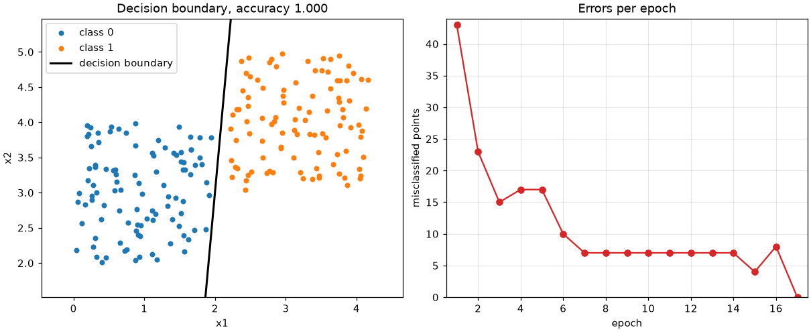
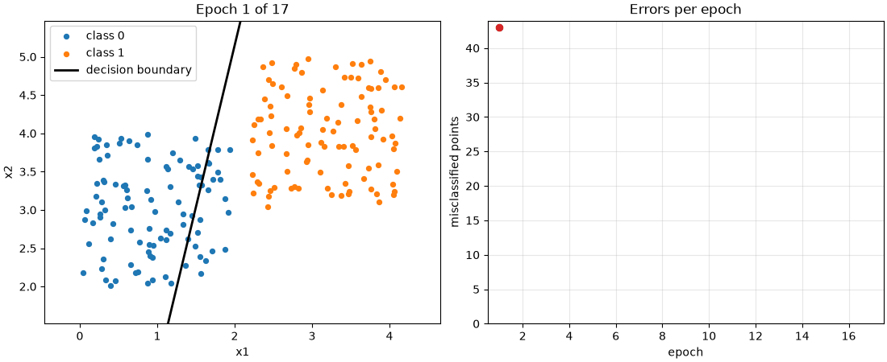
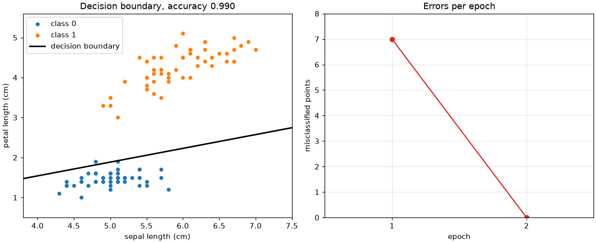

# Перцептрон

Лабораторная работа 1 по Python, тема А1. Однослойный перцептрон для
классификации на два класса (0 и 1).

Программа генерирует два линейно разделимых облака точек (или берёт iris),
обучает перцептрон, печатает точность на обучающей и тестовой выборке и по
желанию сохраняет графики.



## Как работает перцептрон

Для точки x считается взвешенная сумма z = w . x + b, затем порог:
класс 1, если z >= 0, иначе 0. При обучении для каждой точки:

```
w = w + lr * (target - pred) * x
b = b + lr * (target - pred)
```

Если ответ верный, target - pred = 0 и веса не меняются. Один проход по
всем точкам - эпоха. Обучение останавливается, когда за эпоху не было ни
одной ошибки, или когда закончились эпохи (--epochs).

## Установка

Нужен [uv](https://docs.astral.sh/uv/).

```
uv sync
```

## Запуск

```
uv run python perceptron.py --samples 200 --lr 0.1 --epochs 50
```

Пример вывода:

```
Data: synthetic blobs, 200 samples
      160 for training, 40 for testing
Epochs run: 17 of 50
Errors per epoch: [43, 23, 15, 17, 17, 10, 7, 7, 7, 7, 7, 7, 7, 7, 4, 8, 0]
Weights: [ 2.027 -0.184], bias: -3.500
Train accuracy: 1.000
Test accuracy:  1.000
```

Аргументы:

| Флаг | По умолчанию | Что делает |
|---|---|---|
| --samples N | 200 | число точек синтетических данных |
| --lr X | 0.1 | шаг обучения (learning rate) |
| --epochs N | 50 | максимум эпох |
| --seed N | 42 | seed генератора, одинаковый seed дает одинаковые данные |
| --iris | выкл. | вместо синтетики iris: setosa против versicolor |
| --plot FILE.png | нет | сохранить границу решения и график ошибок по эпохам |
| --animate FILE.gif | нет | сохранить анимацию обучения, кадр на каждую эпоху |

Неверные значения дают сообщение об ошибке, а не трейсбек:

```
> uv run python perceptron.py --samples -5
perceptron: error: argument --samples: must be positive, got -5
```

Графики и анимация:

```
uv run python perceptron.py --plot docs/blobs.png --animate docs/training.gif
uv run python perceptron.py --iris --plot docs/iris.png
```





## Расширения

Отдельный подпакет `perceptron_lab.extras`, основная часть от него не
зависит:

- `multiclass.py` - один-против-всех (one-vs-rest) для трех видов iris:
  по перцептрону на класс, ответ - класс с наибольшим z. Задача "versicolor
  или нет" не разделима прямой, поэтому используется pocket-перцептрон: он
  оставляет веса лучшей эпохи.
- `compare.py` - сравнение точности с `sklearn.linear_model.Perceptron`.

```
uv run python -m perceptron_lab.extras
```

## Проверки

```
uv run pytest
uv run ruff check
uv run ruff format --check
uv run mypy
```

Те же проверки запускаются в GitHub Actions на каждый push
(`.github/workflows/ci.yml`).

## Структура

```
perceptron.py              точка входа
src/perceptron_lab/
    model.py               класс Perceptron
    data.py                синтетические данные, iris, разбиение train/test
    plots.py               граница решения, ошибки по эпохам, анимация
    cli.py                 аргументы командной строки
    extras/                one-vs-rest и сравнение со sklearn
tests/                     тесты pytest
```
